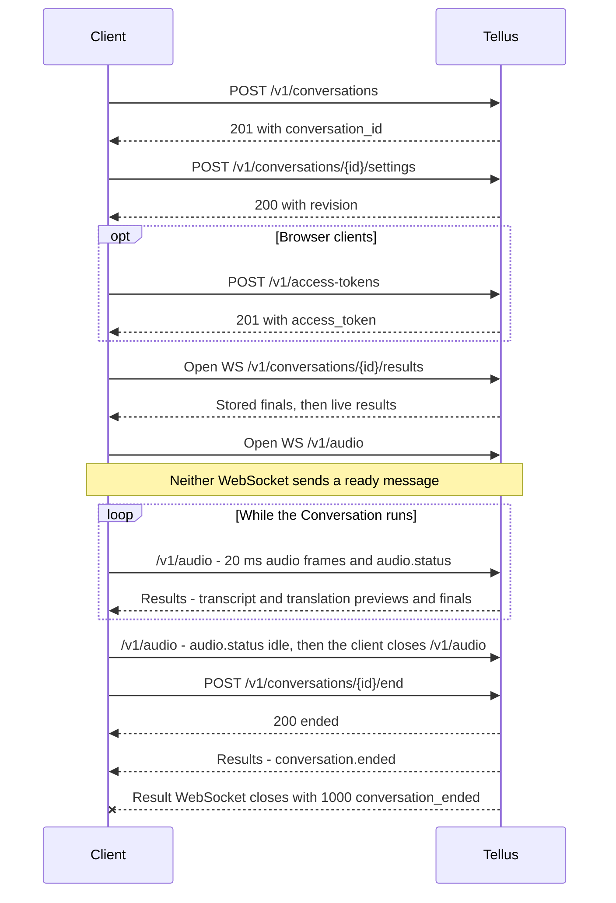
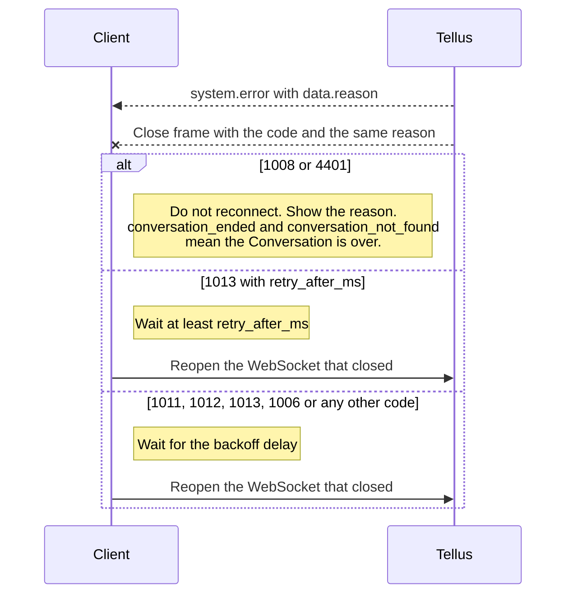
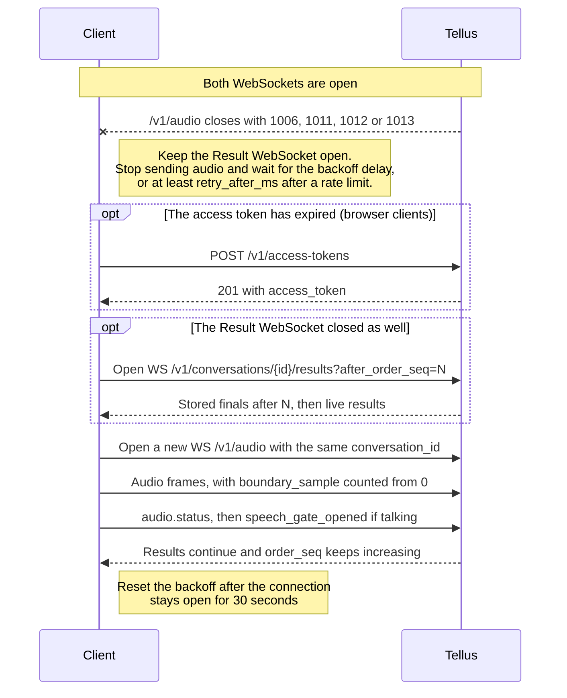
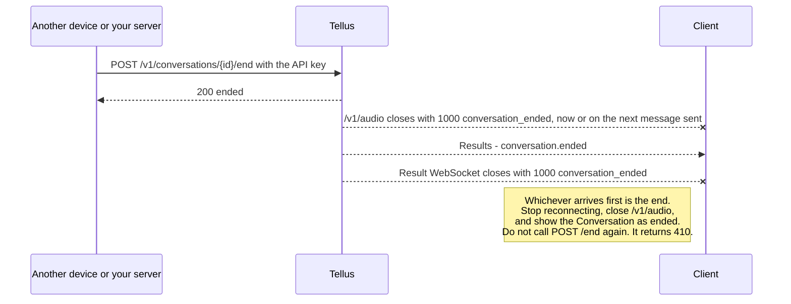

# Tellus realtime translation examples

Standalone realtime translation examples that can be copied and used independently.

- [`web/`](./web/README.md): Vite + React web example
- [`mobile/`](./mobile/README.md): Expo + React Native mobile example
- [`flutter/`](./flutter/README.md): Flutter mobile example (iOS and Android)
- [`desktop/`](./desktop/README.md): Electron desktop example using the Tellus native audio engine

None of the apps depend on local Realtime Speech server code. All of them connect directly to the Tellus public speech server below. Issue `API_KEY` and `TELLUS_AUDIO_ENGINE_TOKEN` in the Tellus API Console (https://public.api.tellus.ai.kr/console).

- HTTP: `https://public.speech.tellus.ai.kr`
- WebSocket: `wss://public.speech.tellus.ai.kr`

Each app has its own packages and realtime communication implementation, with no imports between them.
`API_KEY` in each app's `.env` file is read by that app's development server, not by the app:
the Vite server for web and desktop, the Expo (Metro) server for mobile, and a small Node server
(`scripts/dev-server.mjs`) for Flutter. The app calls its development server, which adds
`Authorization: Bearer <API key>` and forwards the call to Tellus, and opens the WebSockets with an
access token that the server gets for it; see
[Base URLs and authentication](#base-urls-and-authentication).

## 플랫폼별 SDK 설치

각 예제는 `npm run setup`으로 필요한 플랫폼 SDK와 엔진을 설치합니다. 모든 예제가 SDK **0.3.15**와 엔진 **0.4.15**를 사용합니다. Node.js 24와 Git이 필요하고, Flutter 예제에는 Flutter도 필요합니다. 별도 SDK 저장소나 엔진 소스를 직접 준비할 필요가 없습니다.

| 예제 | 설치 패키지 |
| --- | --- |
| 웹 | `@tellus-ai/audio-sdk-web` |
| 모바일 | `@tellus-ai/audio-sdk-mobile` |
| Flutter | Flutter plugin `tellus_audio_sdk` (SDK 저장소의 `platforms/flutter`) |
| 데스크톱 | `@tellus-ai/audio-sdk-desktop` |

각 예제 폴더에서 실행합니다.

```sh
cp .env.example .env
# .env에 TELLUS_AUDIO_ENGINE_TOKEN과 API_KEY를 각각 설정합니다.
npm run setup
```

setup은 공개 SDK 저장소의 `v0.3.15`를 각 예제 내부의 `.sdk/`에 내려받고 `scripts/audio-sdk-release.json`의 고정 커밋을 검증한 뒤 JavaScript 패키지를 빌드합니다. `.npmrc`의 `install-links=true`로 해당 플랫폼 패키지를 `node_modules`에 복사하고, 설치 토큰과 같은 환경의 다운로드 서버에서 엔진·checksum·암호화 모델을 준비합니다. Web은 브라우저 자산도 복사합니다. Flutter는 `node_modules`에 복사하지 않고 `.sdk/platforms/flutter`를 `pubspec.yaml`의 path 의존성으로 사용하며, 그 폴더에 엔진을 설치한 뒤 `flutter pub get`을 실행합니다. Rust 빌드나 GitHub 인증은 필요하지 않습니다.

`TELLUS_AUDIO_DOWNLOAD_BASE_URL`은 설치 토큰의 환경과 같아야 합니다. 다운로드 서버에 대상 엔진과 checksum이 게시되고 해당 플랫폼이 허용되어 있어야 setup이 완료됩니다. Web은 `wasm32-emscripten` archive와 checksum을 사용합니다. `.sdk/`는 Git에서 제외하며, 버전을 변경할 때는 네 예제의 `scripts/audio-sdk-release.json`과 웹·모바일·데스크톱 예제의 lockfile을 함께 갱신합니다.

설치 회귀 검증은 저장소 루트에서 `node --test tests/setup-sdk.test.mjs`로 실행합니다. 앱 검증은 Web·Mobile·Flutter의 `npm run verify:pre-commit`, Desktop의 `npm run typecheck && npm test && npm run build`를 각각 사용합니다.

CI는 `.github/workflows/examples.yml` 하나입니다. secret 없이 모든 PR과 `main`·`v2` push에서 실행합니다. 설치 회귀 테스트와, 웹·모바일·데스크톱 예제 각각의 고정 SDK 준비·타입 검사·단위 테스트·빌드, Flutter 예제의 고정 SDK 준비·`flutter analyze`·`flutter test`·스크립트 테스트를 돌리고, 표지용 키로 API 키가 앱(웹 bundle, Expo 설정, 데스크톱 `dist/`, Flutter `.dart-defines.json`)에 들어가지 않는지 확인합니다. 엔진 설치는 설치 토큰이 필요하므로 CI는 SDK의 JavaScript 패키지와 Flutter plugin의 Dart 패키지만 사용합니다. 실제 엔진을 쓰는 검증(시뮬레이터·에뮬레이터 probe, Flutter integration test, 데스크톱 엔진 smoke)은 각 예제 README의 명령으로 로컬에서 실행합니다.

## API contract

The examples use the `/v1` Conversation API of the Tellus public speech server.
This section covers one Conversation from creation to end: the calls to make,
what the server sends, and what a client should do when a connection closes.

The unversioned `/conversations/...` routes are an earlier API with other
message shapes. A Conversation uses one set of routes from creation to end: one
created with `POST /v1/conversations` opens only through `/v1` routes, and the
other family answers it with HTTP `412` or a `1008` close
(`conversation_is_v1`, `conversation_not_v1`).

### Base URLs and authentication

- HTTP base URL: `https://public.speech.tellus.ai.kr`
- WebSocket base URL: `wss://public.speech.tellus.ai.kr`
- The REST endpoints require `Authorization: Bearer <API key>`, with a key
  issued in the Tellus API Console (`tl_test_...` or `tl_live_...`). A
  Conversation belongs to the key that created it; another key gets `403` or
  `404`.
- Both WebSockets need a credential in the handshake, one of:
  - the API key that created the Conversation, in `Authorization: Bearer` or
    `X-API-Key`;
  - an access token for this Conversation, in `Authorization: Bearer` or, for
    browsers that cannot set WebSocket headers, in the `token` query parameter.
- An API key in `token=`, a header together with `token=`, a token for another
  Conversation, or no credential closes the socket with `1008` `auth_failed`.
  Keys never go into a URL.
- While a socket is open the server checks its key again at least every 30
  seconds (for a token, the key that issued it). Once the key is revoked, has
  expired, or changes scope, the socket closes with `4401` and no
  `system.error`. An open socket is not closed when its token expires.
- If the web origin is not registered, a WebSocket closes with `1008`
  `origin_not_allowed`. Ask Tellus to register your origin.

**Access tokens.** `POST /v1/access-tokens` returns a token (`tl_at_...`) that
opens the WebSockets of one Conversation and nothing else; every other HTTP
endpoint answers a token with `403`. A token lasts 15 minutes and can open any
number of connections to its Conversation in that time.

In production, keep the API key on your server: let the server create,
configure, and end the Conversation and issue the token, and give the client
only the token. Whatever a client holds can be read by its user: a key in a web
bundle by anyone who opens the page, a key in a mobile or desktop app by anyone
who has the app.

The examples follow this structure, with their development server in
the place of your backend. None of them holds the API key:

| Example | Who holds the API key | REST calls | WebSockets |
| --- | --- | --- | --- |
| Web | The Vite development server (`npm run dev`, `npm run preview`) | The browser calls the development server, which adds the API key | Access token in `token=` (a browser cannot set WebSocket headers) |
| Mobile | The Expo (Metro) development server on your computer | The app calls the development server over the local network, which adds the API key | Access token in the `Authorization` header |
| Flutter | The Node development server that `npm start` runs next to `flutter run` | The app calls the development server over the local network, which adds the API key | Access token in the `Authorization` header |
| Desktop | The Vite development server that `npm run dev` starts | The Electron main process calls the development server, which adds the API key | Access token in the `Authorization` header |

The development server forwards exactly four calls (create, settings, access
token, end) and nothing else the key could do, and only from this computer
(loopback). A simulator, an emulator, and an Android device behind
`adb reverse` come in through loopback; list other devices, such as a phone on
Wi-Fi, in `TELLUS_EXAMPLE_API_CLIENTS`. Beyond that address check the server
does not know who is calling it. A real backend checks its own login first. A build
that does not run against the development server (the static web `dist/`, a
packaged desktop app, a mobile build without Metro, a Flutter build without its
Node server) cannot start a session until
it is pointed at a backend that provides the same four routes; see each
example's README.

### Conversation flow

A Conversation uses three REST calls and two WebSockets; the web example adds
one call for its access token. After a disconnect, a client reopens only the
WebSockets.



The other cases have their own diagrams below: an
[error close](#close-codes-and-recommended-client-behavior), a
[reconnect](#reconnecting-after-a-disconnect), and a Conversation
[ended from the Tellus side](#ending-a-conversation).

- Save settings before opening either WebSocket. Otherwise the socket closes
  with `1008` `interpretation_settings_not_found`.
- The two WebSockets can be opened in either order, and neither sends a ready
  message. On connect the Result WebSocket first sends the finals already
  stored, then live results, so finals produced before it connected are sent
  too. The examples open the Result WebSocket first.
- A Conversation has one Result WebSocket. Opening another, even on another
  server, closes the open one with `1008` `results_connection_replaced`.
- `languages` holds two or three different languages. If you do not know the
  other party's language, send one supported language plus `"auto"` (for
  example `["ko-KR", "auto"]`). For a single language, use the Dictation API.
- Do not save settings again during a Conversation. Settings take effect only
  when the Conversation's interpretation worker starts; see
  [Changing languages during a Conversation](#changing-languages-during-a-conversation).
- The Result WebSocket is receive-only. Any message the client sends on it
  closes it with `1008`. There is no leave message; to leave, close both
  WebSockets.
- Closing WebSockets does not end a Conversation. Only
  `POST /v1/conversations/{id}/end` ends it.

### REST endpoints

HTTP responses use a common envelope. In errors, `message[0]` is English and
`message[1]`, when present, is Korean. `POST /v1/access-tokens` is the
exception: it answers without the envelope, and reports an error as
`{"detail": "<text>"}`.

```json
{"statusCode": "404", "message": ["Conversation not found.", "대화를 찾을 수 없습니다."], "data": {}}
```

The same rules apply to every endpoint. The response has no `Retry-After`
header; use the [backoff](#close-codes-and-recommended-client-behavior) below.

| Status | Meaning | Retry |
| --- | --- | --- |
| `400` | The request is not valid. | No; fix the request. |
| `401` | The API key is missing, invalid, expired, or revoked. | No; use a valid key. |
| `403` | The key did not create this Conversation, or the credential is an access token. | No. |
| `404` | The Conversation does not exist, or its state expired 24 hours after creation. | No. |
| `409` | A settings save would change what the running interpretation worker has fixed. | No; send the saved values again, or create a new Conversation. |
| `410` | The Conversation has ended. | No. For `/end`, treat it as success. |
| `412` | Another settings save changed `revision` at the same time, or the Conversation was created through the unversioned routes. | Once, after reading the settings again. |
| `500` | Unexpected server error. | Not automatically. Report the `conversation_id` to Tellus if it repeats. |
| `503` | Temporarily unavailable. | Yes, with backoff. |
| No response | The network failed or the request timed out. | `GET .../results`, `POST /v1/access-tokens`, and `POST .../end`: yes, with backoff. The other calls: not automatically, because the request may have been applied. |

#### `POST /v1/conversations`

Create a Conversation for one speaker. The success status is `201`.

The body is optional. A body with settings fields (the fields of
[`POST .../settings`](#post-v1conversationsconversation_idsettings) below)
creates the Conversation and saves its settings in one call; the settings are
checked first, so a `400` creates nothing. The examples send no body and save
the settings with the next call.

Shape of `data` in a successful response without settings:

```json
{
  "conversation_id": "conversation-1"
}
```

With settings, `data` has the shape of the settings response below.

| Status | Meaning |
| --- | --- |
| `400` | Invalid settings in the body. Fix the request; do not retry. |
| `401` | The API key is missing, invalid, expired, or revoked. |
| `503` | Temporarily unavailable; no Conversation was created. Retry with backoff. |

A limit on open sessions per project is planned but not enforced yet. A
Conversation never ends on its own, so end every one you create.

#### `POST /v1/conversations/{conversation_id}/settings`

Save the Conversation's settings. Only the key that created the Conversation
can save them. The success status is `200`.

Save once, before opening the WebSockets. Each save increments `revision` and
replaces the whole settings object. Settings take effect when the
Conversation's interpretation worker starts, so saving again during a
Conversation does not change a running worker; see
[Changing languages during a Conversation](#changing-languages-during-a-conversation).

Request:

```json
{
  "languages": ["ko-KR", "en-US"],
  "transcription": {
    "client_vad": true
  }
}
```

| Field | Required | Description |
| --- | --- | --- |
| `languages` | yes | Two or three different BCP 47 languages, or one language plus `"auto"`. Each utterance is translated into the other languages. |
| `text_to_speech_enabled` | no | Generate speech for final translations (`tts.completed`). Defaults to `false`. |
| `transcription.client_vad` | no | When `true`, the server uses `audio.status.vad.event` as the speech boundary control signal: `speech_gate_opened` re-arms the boundary and `speech_gate_closed` requests utterance finalization. When `false` (default), server-side VAD is the boundary source. |
| `transcription.audio_format` | no | `opus` (default) or `pcm_s16le`. Stored only; the `/v1/audio` query selects the decoding format. |
| `transcription.sample_rate` | no | `16000`. |
| `transcription.num_channels` | no | `1`. |
| `transcription.speech_end_detection` | no | `max_delay_ms` (`500..3000`, default `2000`), `finalization_bias` (`-1.0..1.0`, default `-0.5`), `finalization_speed_level` (`0..3`, default `0`). |
| `terminology`, `name_dictionary` | no | Your own terms and proper nouns for this Conversation, for example `[{"ko-KR": ["교류"], "en-US": ["AC", "alternating current"]}]`. |
| `terminology_category_ids`, `name_dictionary_category_ids` | no | Categories of the company dictionary managed in the console, by ID (`GET /v1/terminology/category`). A `/v1` Conversation reads only the categories selected here. |
| `transcription.terminology_languages`, `transcription.name_dictionary_languages` | no | The Conversation languages whose dictionary expressions go to speech recognition. Omitted or `[]` sends none; translation always uses every language of an entry. |

The examples send `languages` and `transcription.client_vad` only. A field that
this API does not know, such as the top-level `client_vad` or `translation` of
the unversioned routes, is ignored without an error.

Supported languages (`GET /v1/conversations/language-catalog`, no credential
needed): `ko-KR`, `en-US`, `ja-JP`, `zh-CN`, `es-ES`, `fr-FR`, `de-DE`, `vi-VN`,
`pl-PL`, `th-TH`, `ru-RU`, `it-IT`, `id-ID`, `fil-PH`.

Shape of `data` in a successful response:

```json
{
  "conversation_id": "conversation-1",
  "languages": ["ko-KR", "en-US"],
  "text_to_speech_enabled": false,
  "revision": 1,
  "terminology": [],
  "name_dictionary": [],
  "terminology_category_ids": [],
  "name_dictionary_category_ids": [],
  "transcription": {
    "audio_format": "opus",
    "sample_rate": 16000,
    "num_channels": 1,
    "client_vad": true,
    "speech_end_detection": null,
    "terminology_languages": [],
    "name_dictionary_languages": []
  }
}
```

`GET /v1/conversations/{conversation_id}/settings` returns the saved settings
in the same shape, or `404` when none were saved.

| Status | Meaning |
| --- | --- |
| `400` | Invalid request body: one language, four or more, a repeated or unsupported language, invalid transcription options, or a dictionary category that does not exist. Fix the request; do not retry. |
| `401` | The API key is missing, invalid, expired, or revoked. |
| `403` | The key did not create this Conversation. |
| `404` | The Conversation does not exist (or its state expired 24 hours after creation). |
| `409` | The interpretation worker already started, and the save would change its dictionaries or their speech recognition languages. |
| `410` | The Conversation has ended. |
| `412` | Another save changed the settings `revision` at the same time (read the settings again, then save once more), or the Conversation was created through the unversioned routes. |
| `503` | Temporarily unavailable. Retry with backoff. |

#### `POST /v1/access-tokens`

Issue an access token for the WebSockets of one Conversation. Only an API key
can call it, and only for a Conversation that the key created and that has not
ended. The success status is `201`, and the response has no envelope.

Request:

```json
{
  "session_kind": "conversation",
  "session_id": "conversation-1"
}
```

Response:

```json
{
  "access_token": "tl_at_...",
  "expires_at_ms": 1800000900000
}
```

A token is accepted in three places: the handshake of `/v1/audio`, the
handshake of the Result WebSocket, and the `access_token` of the engine
approval messages on `/v1/audio`. It is not stored on the server, so issuing
another one is always safe. Issue a new one when the current token is close to
`expires_at_ms` and the client needs a new connection or an engine renewal.

| Status | Meaning |
| --- | --- |
| `400` | Missing or malformed body. |
| `401` | The API key is missing, invalid, expired, or revoked. |
| `403` | The credential is an access token. |
| `404` | The Conversation does not exist or was created by another key. |
| `410` | The Conversation has ended. |
| `503` | Temporarily unavailable, or access tokens are not enabled on this server. |

#### `POST /v1/conversations/{conversation_id}/end`

End the Conversation. Only the key that created the Conversation can end it.
The success status is `200`. There is no request body.

The server closes `/v1/audio`, then sends `conversation.ended` on the Result
WebSocket and closes it with `1000`. The HTTP response and
`conversation.ended` can arrive in either order; keep the Result WebSocket open
until `conversation.ended` arrives.

This call is not idempotent: a second call returns `410`, which means the
Conversation has already ended. Call it on every exit path. A Conversation that
is never ended stays open until its state expires 24 hours after creation, and
after that it can no longer be ended.

Shape of `data` in a successful response:

```json
{
  "conversation_id": "conversation-1",
  "ended": true
}
```

| Status | Meaning |
| --- | --- |
| `401` | The API key is missing, invalid, expired, or revoked. |
| `403` | The key did not create this Conversation. |
| `404` | The Conversation does not exist, or its state expired 24 hours after creation. It can no longer be ended. |
| `410` | The Conversation has already ended. Treat this as success. |
| `503` | Temporarily unavailable. The Conversation stays open, and new `/v1/audio` connections may be rejected until this call succeeds. Call again. |

#### `GET /v1/conversations/{conversation_id}/results`

Return the Conversation's stored final results, ordered by `order_seq`. Only
the key that created the Conversation can read them. Previews are not stored.
The WebSocket of the same path is told apart by the method.

Each page has at most `limit` utterances (`1..100`, default `100`) and starts
from the first one. Call without `cursor` for the first page; while `has_more`
is `true`, call again with `cursor=<next_cursor>`.

Shape of `data` in a successful response:

```json
{
  "utterances": [
    {
      "order_seq": 0,
      "transcript": "안녕하세요.",
      "source_language": "ko-KR",
      "speaker_id": "1",
      "start_ms": 1000,
      "end_ms": 2000,
      "confidence": 98,
      "translations": [
        { "translation": "Hello.", "target_language": "en-US" }
      ]
    },
    {
      "order_seq": 1,
      "transcript": "반갑습니다.",
      "source_language": "ko-KR",
      "speaker_id": "1",
      "start_ms": 2400,
      "end_ms": 3100,
      "confidence": 97,
      "translations": []
    }
  ],
  "next_cursor": null,
  "has_more": false
}
```

One item is one utterance, with the same `order_seq` and field names as the
items of its result messages. `translations` holds every stored translation,
one per target language; an utterance whose translation is not stored yet has
`translations: []`. A language, speaker, time, or confidence that the server
does not know is `null`.

A client rarely needs this endpoint for a reconnect: a new Result WebSocket
with `after_order_seq` receives the stored finals itself. Use it for the final
that can still be missing at that moment, and to read a Conversation after it
ended.

| Status | Meaning |
| --- | --- |
| `400` | Invalid `limit` or `cursor`. |
| `401` | The API key is missing, invalid, expired, or revoked. |
| `403` | The key did not create this Conversation. |
| `404` | The Conversation does not exist, or its state expired 24 hours after creation. |
| `503` | Temporarily unavailable. Retry with backoff. |

### Result WebSocket

Endpoint:

```text
wss://public.speech.tellus.ai.kr/v1/conversations/{conversation_id}/results
```

Receive transcripts, translations, and the end of the Conversation.

| Query parameter | Required | Description |
| --- | --- | --- |
| `token` | For browsers | An access token, when the credential cannot go into a header. Never an API key. |
| `after_order_seq` | no | The last `order_seq` whose finals the client has handled in full (`0` or greater). The server skips the stored finals at or below it. |

- Any other query parameter, a repeated one, or a malformed value closes the
  socket with `1008` `invalid_query_parameter`.
- This WebSocket is receive-only; any text or binary message from the client
  closes it with `1008` `result_socket_read_only`. There is no leave message.
- There is no ready message. On connect the server first sends the stored
  finals (`transcript.final` and `translation.final`, in the same shape as live
  ones), then continues with live results. Previews, and speech produced before
  the connection, are not sent again.
- A Conversation has one Result WebSocket. A newer one closes this socket with
  `1008` `results_connection_replaced`.
- The server sends `transcript.preview`, `transcript.final`,
  `translation.preview`, `translation.final`, `settings.updated` after each
  settings save, `tts.completed` and `tts.skipped` for speech,
  `conversation.ended`, and `system.error` before most error closes. There are
  no participant or presence messages. The examples handle the four result
  types, `conversation.ended`, and `system.error`, and ignore the rest; ignore
  a `type` you do not know.
- If the server cannot deliver a message on this socket, it closes it with
  `1013` `result_send_failed` and no `system.error`. Reconnect with backoff and
  `after_order_seq`.

#### Result messages

A result message has only `type` and `data`. The top-level `type` is the kind of
result, and the text arrives as an array of items: `data.utterances[]` for a
transcript (text in `transcript`) and `data.translations[]` for a translation
(text in `translation`).

A preview carries the open `order_seq` in `data` and replaces the earlier
preview of that `order_seq` as a whole:

```json
{
  "type": "transcript.preview",
  "data": {
    "conversation_id": "conversation-1",
    "order_seq": 2,
    "utterances": [
      { "transcript": "네 그럼 다음 안건으로", "source_language": "ko-KR", "speaker_id": "1", "start_ms": 1352, "end_ms": 3100 },
      { "transcript": "Let's check", "source_language": "en-US", "speaker_id": "1", "start_ms": 3160, "end_ms": 3900 }
    ]
  }
}
```

A final carries `order_seq` in each item. Finals produced at the same moment
arrive in one message:

```json
{
  "type": "transcript.final",
  "data": {
    "conversation_id": "conversation-1",
    "utterances": [
      { "order_seq": 2, "transcript": "네 그럼 다음 안건으로 넘어가겠습니다", "source_language": "ko-KR", "speaker_id": "1", "start_ms": 1352, "end_ms": 4212 },
      { "order_seq": 3, "transcript": "Let's check the budget first.", "source_language": "en-US", "speaker_id": "1", "start_ms": 4260, "end_ms": 6100 }
    ]
  }
}
```

A `translation.final` carries one item, and one message is sent per finished
translation:

```json
{
  "type": "translation.final",
  "data": {
    "conversation_id": "conversation-1",
    "translations": [
      { "order_seq": 2, "translation": "Then let's move on to the next item.", "source_language": "ko-KR", "target_language": "en-US", "speaker_id": "1", "start_ms": 1352, "end_ms": 4212 }
    ]
  }
}
```

A `translation.preview` has `data.order_seq` and one `data.translations[]` item
per item of the transcript preview, in the same order.

| Field | Description |
| --- | --- |
| `data.order_seq` (previews) | The open utterance. Usually the last final `order_seq` + 1, but a number can be skipped; use the value as it is. |
| item `order_seq` (finals) | Conversation-global utterance order, starting at 0. It keeps increasing across audio reconnects and worker restarts, and the transcript and the translations of one utterance share it. |
| item `source_language`, `target_language` | Always present; `null` when unknown. A transcript item has no `target_language`. In a `translation.preview` of a three-language Conversation, an item whose `target_language` is `null` is an empty slot. |
| item `speaker_id`, `start_ms`, `end_ms` | Speaker label and audio timeline in milliseconds; `null` when unknown. A preview `end_ms` can still change. |

Client handling rules:

- The server splits an utterance where the language or the speaker changes,
  also before the speaker pauses. So `order_seq` can move on without a silence,
  a final can be shorter than its preview (the rest continues under the next
  `order_seq`), and several finals can arrive in a row.
- When a final arrives, replace the preview of its `order_seq` with it. Drop a
  preview whose `order_seq` already has its final.
- De-duplicate `transcript.final` items by `order_seq`, and
  `translation.final` items by `order_seq` + `target_language`. Stored finals
  sent after a reconnect can repeat ones the client already has.
- `order_seq` starts at 0, so do not test it for truthiness. Order the rows by
  `order_seq`.
- In a Conversation with `"auto"`, a `translation.final` with an empty
  `translation` and `target_language` `"auto"` means that the other party's
  language is not known yet; that utterance is not translated later.

The examples show one row per `order_seq`: the items of a preview are joined
into one text, and each item of a final becomes its own row.

When the Conversation ends, the server closes `/v1/audio`, then sends
`conversation.ended` and closes this socket with `1000` `conversation_ended`.
Treat `conversation.ended` or `1000` as the end of the Conversation and do not
reconnect.

```json
{
  "type": "conversation.ended",
  "data": {
    "conversation_id": "conversation-1",
    "subject_id": null,
    "ended_at": 1800000035000
  }
}
```

`system.error` is sent on the same socket right before an error close.
`statusCode` is the close code that follows. `data.reason` is a stable code,
and the close frame repeats it as its reason text (`CloseEvent.reason`).
`message` is for display. `data` may also contain `conversation_id` and
`retry_after_ms`.

```json
{
  "type": "system.error",
  "statusCode": "1013",
  "message": ["Audio pipeline reconnect rate limit exceeded."],
  "data": {
    "conversation_id": "conversation-1",
    "reason": "audio_pipeline_activation_rate_limited",
    "retry_after_ms": 800
  }
}
```

| Reason | Code | Meaning | Retry |
| --- | --- | --- | --- |
| `conversation_ended` | `1000` | The Conversation ended while this socket was open. Follows `conversation.ended`; no `system.error`. | No; treat as ended. |
| `conversation_ended`, `conversation_not_found` | `1008` | The Conversation had already ended, or does not exist, when connecting. | No; treat as ended. |
| `auth_failed` | `1008` | No credential, a wrong or expired one, a token for another Conversation, or an API key in `token=`. | No; fix the credential. |
| `origin_not_allowed` | `1008` | The web origin is not registered. | No; ask Tellus to register the origin. |
| `interpretation_settings_not_found` | `1008` | Settings were not saved before connecting. | No; connect again after saving settings. |
| `v1_settings_required`, `conversation_not_v1` | `1008` | The settings were saved, or the Conversation was created, through the unversioned routes. | No; use one set of routes for a Conversation. |
| `invalid_query_parameter` | `1008` | The URL has a query other than `token` and one valid `after_order_seq`. | No; fix the URL. |
| `result_socket_read_only` | `1008` | The client sent a message. | No; do not send on this socket. |
| `results_connection_replaced` | `1008` | A newer Result WebSocket for the same Conversation replaced this socket. | No; ignore it if you opened the newer socket, otherwise tell the user. |
| `conversation_creator_missing` | `1008` | The Conversation record has no creator. | No; create a new Conversation. |
| `internal_error` | `1011` | Unexpected server error. | Yes, with backoff. |
| `temporarily_unavailable`, `result_stream_bus_subscription_timeout` | `1013` | Conversation state, settings, stored finals, or result delivery is temporarily unavailable. These can arrive several seconds after the socket opens. | Yes, with backoff and `after_order_seq`. |
| `result_send_failed` | `1013` | The server could not deliver a message. No `system.error`. | Yes, with backoff and `after_order_seq`. |
| `API key expired`, `API key verification failed` | `4401` | The key behind this socket was revoked, expired, or changed scope. No `system.error`. | No; use a valid key. |

### Audio WebSocket

Endpoint:

```text
wss://public.speech.tellus.ai.kr/v1/audio?conversation_id={conversation_id}&audio_format={opus|pcm16}
```

Stream one speaker's audio into a Conversation. Save the settings first.

| Query parameter | Required | Default | Values |
| --- | --- | --- | --- |
| `conversation_id` | yes | - | - |
| `audio_format` | no | `opus` | `pcm16`, `opus` |
| `token` | For browsers | - | An access token, when the credential cannot go into a header. Never an API key. |

- The client sends binary audio frames in the `audio_format` of the URL, text
  JSON `audio.status` messages for microphone and client VAD state, and
  optional `audio.discontinuity` messages when captured audio was dropped.
- Send one 20 ms frame per binary message: a raw Opus packet with no Ogg or
  WebM container, or with `audio_format=pcm16` exactly 640 bytes of 16 kHz mono
  signed 16-bit little-endian PCM. Audio in another shape, such as recorder
  chunks in a container, is accepted but produces no results and no error. The
  `/v1/audio` query alone selects the decoding format.
- The server sends nothing on success: no ready message and no
  acknowledgement. It sends `system.error` before most error closes. Results
  arrive on the Result WebSocket.
- Send audio first. The server ignores, without an error, an `audio.status`
  that arrives before it has started processing this socket's audio. This can
  happen in the first moments of a socket and again after about 5 minutes
  without audio, so a status is not guaranteed to apply even after the first
  frame.
- The examples send 16 kHz mono Opus at 64 kbps in 20 ms frames, encoded by the
  Tellus audio SDK.
- `/audio` is an earlier path of this endpoint, kept for Conversations of the
  unversioned routes. Use `/v1/audio`.

Connection rules:

- Each connection replaces the speaker's previous `/v1/audio` connection. Close
  the old socket yourself: on the same server instance it is not closed and its
  frames are ignored; on another instance it closes on its next message with
  `1008` `audio_connection_replaced`. A connection that loses a simultaneous
  race closes the same way. Do not reconnect a replaced socket: either you
  already opened the newer one, or another device or tab is using the
  Conversation.
- Reconnects are limited to five in a row, then one per second, per speaker.
  Over the limit the socket closes with `1013`
  `audio_pipeline_activation_rate_limited` and `data.retry_after_ms`.
- Audio sent while disconnected is not replayed. On a new socket,
  `boundary_sample` restarts at 0: it counts 16 kHz samples from the first
  audio frame sent on that socket.
- With `client_vad` true the speech gate starts closed on every socket: no
  audio is recognized until `speech_gate_opened` arrives with `mic.state`
  `capturing`. Audio sent while the gate is closed is discarded, apart from a
  short lead-in. Open the gate again after a pause and after every reconnect.
- Interpretation stops about 15 minutes after the last audio frame, without
  closing this socket or sending a message; audio sent later on the same socket
  produces no results. If no audio was sent for 10 minutes or longer,
  including pauses, reconnect `/v1/audio` before sending again.
- When the Conversation ends, this socket closes with `1000`
  `conversation_ended` and no `system.error`. Depending on server
  configuration the close arrives right away or on the next message sent, so a
  socket that sends nothing can stay open. Use `conversation.ended` on the
  Result WebSocket as the end signal and close this socket yourself.
- `audio.discontinuity` is only logged. An invalid `audio.discontinuity`, or a
  text message with an unknown `type` or `version`, is ignored and does not
  close the socket.

#### `audio.status`

```json
{
  "type": "audio.status",
  "version": 1,
  "boundary_sample": 32000,
  "mic": { "state": "capturing" },
  "vad": {
    "enabled": true,
    "event": "speech_gate_closed"
  }
}
```

Every `audio.status` must carry `type`, `version`, `boundary_sample`,
`mic.state`, and `vad.enabled`, also when `client_vad` is false. A missing
field closes the socket with `1008` `invalid_audio_status`.

| Field | Description |
| --- | --- |
| `type` | Must be `audio.status`. |
| `version` | Must be `1`. |
| `status_seq` | Deprecated and optional. The server ignores this value and applies statuses in the order they arrive on the connection. |
| `boundary_sample` | Non-negative integer audio sample cursor where this status applies on the uplink timeline; a fractional value such as `320.0` is rejected. `sample` is accepted as an alias. |
| `mic.state` | `disabled`, `idle`, `capturing`, `paused`, `permission_denied`, or `error`. |
| `vad.enabled` | `true` when the client VAD detector is enabled. A `speech_gate_closed` event requests utterance finalization only when this is `true`. |
| `vad.event` | Optional speech gate transition event, sent only on gate transitions; omit or null it for ordinary status updates. |

With `client_vad` true, `vad.event` is the speech boundary control signal.
`speech_gate_opened` (with `mic.state` `capturing`) re-arms the speech boundary
at that boundary sample, and `speech_gate_closed` (with `mic.state`
`capturing` and `vad.enabled` true) requests utterance finalization at that
boundary sample. Send each event only when the client speech gate actually
transitions. Any other `vad` field, such as `gate` or `level`, is ignored.

| `data.reason` | Code | Meaning | Retry |
| --- | --- | --- | --- |
| `conversation_ended` | `1000` | The Conversation ended while this socket was open. No `system.error`. | No; treat as ended. |
| `conversation_ended`, `conversation_not_found` | `1008` | The Conversation had already ended, or does not exist, when connecting. | No; treat as ended. |
| `auth_failed` | `1008` | No credential, a wrong or expired one, a token for another Conversation, or an API key in `token=`. | No; fix the credential. |
| `origin_not_allowed` | `1008` | The web origin is not registered. | No; ask Tellus to register the origin. |
| `interpretation_settings_not_found` | `1008` | Settings were not saved before connecting. | No; connect again after saving settings. |
| `invalid_query_parameter`, `unsupported_audio_format` | `1008` | The URL has an unexpected or malformed query parameter, or an unsupported `audio_format`. | No; fix the URL. |
| `invalid_audio_status` | `1008` | An `audio.status` message is not valid. `data.detail` names the field when a field has the wrong type or value. | No; fix the message. |
| `malformed_audio_control_json` | `1008` | A text message is not a JSON object. | No; fix the message. |
| `invalid_audio_control_identity` | `1008` | A text message has no string `type` or positive integer `version`. | No; fix the message. |
| `audio_connection_replaced` | `1008` | A newer `/v1/audio` connection for the same speaker replaced this socket. | No; ignore it if you opened the newer socket, otherwise tell the user. |
| `interpretation_settings_changed` | `1008` | Settings were saved again while the earlier interpretation worker runs. | No; create a new Conversation. |
| `worker_bootstrap_failed`, `transcription_unavailable`, `translation_unavailable`, `common_dictionary_rejected` | `1008` | The interpretation cannot start for a reason that a retry will not fix. | No; report the `conversation_id` to Tellus. |
| `conversation_creator_missing` | `1008` | The Conversation record has no creator. | No; create a new Conversation. |
| `invalid_request` | `1008` | Any other invalid request. | No; fix the client request. |
| `audio_pipeline_activation_rate_limited` | `1013` | Too many reconnects for this speaker. | After `data.retry_after_ms`. |
| `worker_capacity_exceeded`, `audio_uplink_dependency_unavailable`, `pipeline_epoch_allocation_failed`, `temporarily_unavailable` | `1013` | No worker capacity or a temporary storage failure. | Yes, with backoff. |
| `interpretation_worker_stopped` | `1013` | The interpretation worker stopped while the socket was open and could not be restarted. | Yes, with backoff; reconnecting restarts interpretation. |
| `participant_audio_cursor_conflict`, `participant_audio_cursor_corrupt` | `1011` | Server-side audio state error. | Yes, with backoff; report the `conversation_id` if it repeats. |
| `worker_bootstrap_failed`, `internal_error` | `1011` | The interpretation worker could not start, or an unexpected server error. | Yes, with backoff; report the `conversation_id` if it repeats. |
| `API key expired`, `API key verification failed` | `4401` | The key behind this socket was revoked, expired, or changed scope. No `system.error`. | No; use a valid key. |

**Engine approval.** The Tellus audio SDK of the examples also sends
`audio.authenticate` and `engine.renew` on this socket, to obtain and renew the
permit of its audio engine. Their `access_token` is the API key, or an access
token for this Conversation; the server checks it on every renewal, so send a
current token each time. An approval lasts up to ten minutes and is not
shortened by the expiry of the token it was issued with. These requests have
their own `engine_*` close reasons, listed in the
[desktop README](./desktop/README.md#error-handling-and-reconnects). One of
them, `engine_authorization_expired`, is the only `1008` that the desktop
example answers with a reconnect: a new `/v1/audio` socket is authorized again
from the start.

### Close codes and recommended client behavior

Decide whether to reconnect from the close code alone:

- `1000`: the Conversation ended. Do not reconnect.
- `1008` and `4401`: do not reconnect. Show the reason.
- Any other code: reconnect with backoff.



Every `system.error` carries `data.reason`, and the close frame repeats the
same value as its reason text, so `CloseEvent.reason` is enough to tell why a
socket closed. Use the reason and `message` for display and logs, and the
close code for the decision. No `system.error` precedes `1000`, `1012`,
`4401`, a `1011` caused by a missing pong, a `1013` `result_send_failed`, or a
`1006`. `1012` and `1006` carry no close reason either.

| Code | Reason | When | Socket | Retry | Client action |
| --- | --- | --- | --- | --- | --- |
| `1000` | `conversation_ended` | The Conversation ended with `POST .../end` while the socket was open. The Result WebSocket closes right after `conversation.ended`. | both | no | Show the Conversation as ended. |
| `1008` | `conversation_ended`, `conversation_not_found` | Connecting to a Conversation that has already ended or does not exist (including the 24-hour expiry below). | both | no | Show the Conversation as ended. Create a new Conversation to continue. |
| `1008` | `auth_failed` | No credential, a wrong or expired one, a token for another Conversation, or an API key in `token=`. | both | no | Fix the credential. With an expired access token, issue a new one before connecting. |
| `1008` | `origin_not_allowed` | The web origin is not registered. | both | no | Ask Tellus to register your origin. |
| `1008` | `invalid_query_parameter`, `unsupported_audio_format` | The Result WebSocket URL has a query other than `token` and one valid `after_order_seq`, or the `/v1/audio` URL has an unexpected or malformed query parameter or an unsupported `audio_format`. | both | no | Fix the URL. |
| `1008` | `interpretation_settings_not_found` | The socket opened before settings were saved. | both | no | Save settings, then connect again. |
| `1008` | `v1_settings_required`, `conversation_not_v1` | The settings were saved, or the Conversation was created, through the unversioned routes. | both | no | Use one set of routes for a Conversation. |
| `1008` | `results_connection_replaced` | A newer Result WebSocket for the same Conversation replaced this socket. | Result | no | If you opened the newer socket, ignore this close. Otherwise another device or tab is using the Conversation; tell the user. |
| `1008` | `invalid_audio_status`, `malformed_audio_control_json`, `invalid_audio_control_identity` | A text message sent on `/v1/audio` is not valid. When a field has the wrong type or value, `invalid_audio_status` carries `data.detail` naming the field. | `/v1/audio` | no | Fix the message. |
| `1008` | `result_socket_read_only` | The client sent a message on the Result WebSocket. | Result | no | Do not send on this socket. |
| `1008` | `conversation_creator_missing` | The Conversation record has no creator. | both | no | Create a new Conversation and report the `conversation_id` to Tellus. |
| `1008` | `invalid_request` | Any other invalid request. | both | no | Fix the client request. |
| `1008` | `interpretation_settings_changed` | Settings were saved again during the Conversation. | `/v1/audio` | no | Create a new Conversation. Show `message`, which names the cause. |
| `1008` | `worker_bootstrap_failed`, `transcription_unavailable`, `translation_unavailable`, `common_dictionary_rejected` | The interpretation cannot start for a reason that a retry will not fix. | `/v1/audio` | no | Do not reconnect. Report the `conversation_id` to Tellus. |
| `1008` | `audio_connection_replaced` | A newer `/v1/audio` connection for the same speaker replaced this socket. | `/v1/audio` | no | If you opened the newer socket, ignore this close. Otherwise another device or tab is using the Conversation; tell the user. |
| `1011` | `internal_error`, `worker_bootstrap_failed`, `participant_audio_cursor_conflict`, `participant_audio_cursor_corrupt`; `keepalive ping timeout` for a missing pong | Internal server error, or no pong within 20 seconds of a ping. | both | yes, backoff | Back off and reconnect. Report the `conversation_id` to Tellus if it repeats. |
| `1012` | none | Server restart or redeploy. | both | yes, after a random 0.5–2 seconds | Wait a random 0.5–2 seconds, reconnect, then back off. |
| `1013` | `audio_pipeline_activation_rate_limited` | `/v1/audio` reconnect rate limit, with `data.retry_after_ms`. | `/v1/audio` | yes, after `retry_after_ms` | Wait at least `retry_after_ms`, then reconnect. |
| `1013` | `worker_capacity_exceeded`, `audio_uplink_dependency_unavailable`, `pipeline_epoch_allocation_failed`, `interpretation_worker_stopped`, `temporarily_unavailable`, `result_stream_bus_subscription_timeout` | Temporarily unavailable or no capacity. | both | yes, backoff | Back off and reconnect. |
| `1013` | `result_send_failed` | The server could not deliver a message on the Result WebSocket. | Result | yes, backoff | Back off and reconnect with `after_order_seq`. |
| `4401` | `API key expired`, `API key verification failed` | The key behind this socket was revoked, expired, or changed scope. | both | no | Stop. Use a valid key for a new Conversation. |
| `1006` | none | Seen by the client, not sent by the server: network loss or a stopped server process. | both | yes, backoff | Back off and reconnect. Retry at once on the browser `online` event. |

New reasons can be added. Handle an unknown reason by its close code.

**Backoff.** Wait 1, 2, 5, 10, and 30 seconds, then every 30 seconds. Reset the
attempt count only after a connection stays open for 30 seconds, because the
server can close a socket right after accepting it. With this schedule
`/v1/audio` reconnects stay under the server limit of five in a row, then one
per second, per speaker.

**Node.js clients.** Use the [`ws`](https://github.com/websockets/ws) package
instead of the `WebSocket` built into Node.js, which is also the one in the
Electron main process. Against the public speech server, the built-in client reports
an error close as `1006` with no message and no reason (observed with Node.js
22.19 and Electron 44.5), so every error close looks like a network drop and
the client keeps reconnecting. It loses a compressed message that is followed
at once by the close frame and the end of the connection. Chrome and `ws`
report the code, the reason, and the message. `ws` can also send the
`Authorization` header that the handshake needs.

Depending on server configuration, a settings change, missing worker capacity,
or a worker start failure can also happen without any close: the sockets stay
open but no results arrive. The result watchdog in
[Network loss and server failures](#network-loss-and-server-failures) covers
this case.

The three examples apply these rules. Each README describes what its example
does, and where the platform makes it differ, under
**Error Handling and Reconnects**:
[web](./web/README.md#error-handling-and-reconnects),
[mobile](./mobile/README.md#error-handling-and-reconnects),
[desktop](./desktop/README.md#error-handling-and-reconnects).

### Reconnecting after a disconnect

The server accepts a new `/v1/audio` connection for the same `conversation_id`
as the continuation of the previous one. `order_seq` keeps increasing across
reconnects.



1. Reopen only the socket that closed. If both closed, reopen them in either
   order.
2. Remove the old socket's handlers and close it before opening the new one. A
   replaced `/v1/audio` socket on the same server instance is not closed by the
   server; its frames are ignored. Ignore a late close from the old socket, for
   example `1008` `audio_connection_replaced` or `results_connection_replaced`.
3. Do not save settings again; see
   [Changing languages during a Conversation](#changing-languages-during-a-conversation).
4. Reopen the Result WebSocket with `after_order_seq` set to the last
   `order_seq` whose `transcript.final` and translations you have all handled.
   The server skips the stored finals at or below it, sends the stored finals
   after it, then continues live. Drop duplicates by `order_seq` for
   `transcript.final` items and by `order_seq` and `target_language` for
   `translation.final` items. Previews and speech (`tts.completed`) from the
   gap are not sent again.
5. On a new `/v1/audio` socket, count `boundary_sample` from 0 again. It is the
   16 kHz sample position counted from the first audio frame sent on that
   socket.
6. Send audio first; an `audio.status` that arrives before the server has
   started processing this socket's audio is ignored. With `client_vad: true`,
   reset the client VAD. The speech gate starts closed on every socket, so once
   audio is flowing and the speaker is talking, send `speech_gate_opened`
   again; otherwise that utterance is not recognized.
7. Audio from the disconnected period is not processed later. Drop it, or keep
   a short buffer (for example the last 0.5 seconds) and send it right after
   reconnecting.
8. A final produced at the moment of reconnecting can still be missing. Fill it
   from `GET /v1/conversations/{id}/results`: a page holds at most 100
   `utterances` from the start of the Conversation, each with its stored
   `translations`; pass `next_cursor` as `cursor` while `has_more` is true.
   Previews are not stored.

### Ending a Conversation

`conversation.ended` is sent only after `POST /v1/conversations/{id}/end`
succeeds with the key that created the Conversation, including when another
device, tab, or your server ends it. The server closes `/v1/audio` first, then
sends `conversation.ended` on the Result WebSocket and closes it with `1000`.



- Treat whichever comes first as the end: `conversation.ended`, a Result
  `1000`, or a `/v1/audio` `1000`. Stop reconnecting and close `/v1/audio`
  yourself. A reconnect after the end is rejected with `1008`
  `conversation_ended`; treat that as the end too.
- Show the Conversation as ended, not as an error, and do not call `/end` again
  (it returns `410`).
- To end a Conversation yourself:
  1. Send `audio.status` with `mic.state` `paused` or `idle`. With
     `client_vad: true` and an open gate, send `speech_gate_closed` first.
  2. Wait briefly (for example 2 seconds) for the last final.
  3. Stop reconnecting, close `/v1/audio`, and call `POST .../end`. Call it
     again on `503`.
  4. Keep the Result WebSocket open until `conversation.ended` arrives. The
     HTTP `200` and `conversation.ended` can arrive in either order.

### Changing languages during a Conversation

A Conversation has two or three languages, and they are fixed when its
interpretation starts. Adding or changing a language during a Conversation is
not supported. To use other languages, end the Conversation and create a new
one.

- Saving settings again increments `revision`, but the interpretation that is
  already running keeps the settings it started with. A save that changes
  `terminology`, `name_dictionary`, their category IDs, or their speech
  recognition languages returns `409` once the worker has started.
- `settings.updated` on the Result WebSocket reports what was saved, not what
  the running interpretation uses. Do not read it as "the languages changed".
- After such a save, the next `/v1/audio` connection can close with `1008`
  `interpretation_settings_changed`. Depending on server configuration it can
  also stay open; the new languages are still not used.
- A save replaces the whole settings object. Fields that are left out, such as
  `text_to_speech_enabled` and `transcription.client_vad`, return to their
  defaults.

**Captions from before the change.** They cannot be received in the new
language. Each utterance is translated once, when it is spoken, between the
languages the Conversation has at that time, and the server does not translate
earlier utterances again.

What stays available is what was produced at the time: the transcripts and the
translations of the earlier Conversation, as finals, from
`GET /v1/conversations/{id}/results` with the key that created it. The new
Conversation has its own `conversation_id` and its own results, so keep the
earlier `conversation_id` if you want to show its captions next to the new
ones.

### Time limits and automatic stops

There is no maximum Conversation length, and the server never ends a
Conversation on its own.

| Limit | Value | When it passes | Recommendation |
| --- | --- | --- | --- |
| Conversation state retention | 24 hours after creation. Activity does not extend it. | New connections, settings, stored results, and `/end` are rejected with `404` or `1008` `conversation_not_found`. Open sockets stay open, but cannot reconnect after they close. | Create a new Conversation per session and end it within 24 hours. |
| Access token | 15 minutes after it was issued. | New connections with it are rejected with `1008` `auth_failed`, and engine renewals with it fail. Open sockets stay open. | Issue a new token before a reconnect or a renewal once the current one is close to `expires_at_ms`. |
| No audio | About 15 minutes after the last audio frame. | Interpretation stops silently. Sockets stay open and no message is sent, but audio sent afterwards produces no results. | If no audio was sent for 10 minutes or longer (including pauses), reconnect `/v1/audio` before sending again. |
| WebSocket ping | Every 25 seconds; the server waits 20 seconds for the pong. | The server closes the socket with `1011` `keepalive ping timeout`. | Browsers answer pings automatically. Do not send application-level ping messages. |
| API key check | At least every 30 seconds on each open socket. | `4401` once the key is revoked, has expired, or changes scope. | Do not reconnect; use a valid key. |
| `/v1/audio` reconnects | Five in a row, then one per second, per speaker. | `1013` `audio_pipeline_activation_rate_limited` with `retry_after_ms`. | Use the backoff above. |

- The server never closes a socket because no audio arrives. As long as pings
  are answered, both WebSockets stay open.
- The 15-minute rule counts audio frames only. Silent frames count as audio, so
  short gaps alone do not stop interpretation.
- A Conversation ends only with `POST .../end`. If it is never called, the
  Conversation stays open, and after 24 hours `/end` also returns `404`, so it
  can no longer be ended or cleaned up. Call `/end` on every exit path,
  including app shutdown and fatal errors.

### Network loss and server failures

The Conversation and `order_seq` are kept in server storage. Within 24 hours of
creation, a client that reconnects with the same `conversation_id` continues
the Conversation after a network drop or a server restart.

| What happened | What the client sees | What to do |
| --- | --- | --- |
| Network loss, or the server process stopped | `1006` on both sockets, no message | Back off and reconnect. Reconnect at once on the browser `online` event. |
| Server restart or redeploy | `1012` on both sockets, no message | Wait a random 0.5–2 seconds, reconnect, then back off. |
| The server is temporarily overloaded or a dependency failed | `1011` or `1013`, usually after `system.error` | Back off and reconnect; after a rate limit wait at least `retry_after_ms`. |
| A REST call fails with `503` or gets no response | HTTP error | Retry a `503` with backoff. After no response, repeat only `GET .../results`, `POST /v1/access-tokens`, and `POST .../end`; a `POST /v1/conversations` that got no response may have created a Conversation. |

After a reconnect the Conversation continues, with these limits:

- Finals produced while the Result WebSocket was closed arrive again when it
  reconnects with `after_order_seq`; previews are lost.
- Audio captured while `/v1/audio` was closed is not processed.
- An utterance that was in progress when `/v1/audio` dropped can end without a
  final. Speech after the reconnect starts a new utterance with a new
  `order_seq`.

**Detecting a broken connection**

- The server pings every 25 seconds, but browsers answer pings without
  notifying the app.
- On `/v1/audio`, watch `bufferedAmount`. If unsent audio stays above about
  2 seconds of audio for more than 5 seconds, close the socket and reconnect.
  Two seconds is 64 KB for PCM16; for Opus it depends on the encoder bitrate
  (16 KB at 64 kbps).
- The Result WebSocket is silent while nobody speaks. Silence alone does not
  mean the socket is broken.
- On the browser `offline` event, wait. On `online`, reconnect at once instead
  of waiting for the backoff.
- Treat a connection attempt that does not open within 10 seconds as failed and
  move to the next backoff step.

**Results stop while the sockets stay open.** If interpretation stops or the
Result WebSocket silently breaks, the sockets can stay open with no results.
This happens after 15 minutes without audio, and also after temporary failures
in the speech engine or server storage, or because of server configuration.
The server sends no close or `system.error` in these cases, so add this
watchdog:

- If the speaker is talking (the client VAD reports speech or the input level
  is high) and no result, including `transcript.preview`, arrives for 20
  seconds, reconnect the Result WebSocket with `after_order_seq` and then
  `/v1/audio`.
- If results still do not arrive, try twice more at 20-second intervals. Then
  tell the user and report the `conversation_id` and the time to Tellus.

The examples do not include the `bufferedAmount` check, this watchdog, or the
reconnect after 10 minutes without audio. They reconnect only when a socket
closes. A reconnecting Result WebSocket sends `after_order_seq`; the examples
do not call `GET .../results`.

**Retrying and giving up**

- Use the backoff above.
- While retrying, show a neutral message such as "The realtime connection is
  unstable; reconnecting." A close code alone does not tell whether the user's
  network, a CDN, or the server caused the problem.
- If you cap automatic retries, let the user choose between trying again and
  ending when the cap is reached. If the user chooses to end, call
  `POST .../end`.
